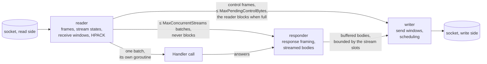

# ADR 0008 — A multiplexed connection is a reader, a responder and a writer

- **Created:** 2026-08-22
- **Revised:** 2026-10-05 (streamed bodies hold the responder; HTTP/3 per-stream writers), 2026-10-07 (renumbered), 2026-10-16 (the HTTP/2 responder no longer waits for the wire), 2026-10-19 (each HTTP/2, then HTTP/3, handler call on a goroutine of its own), 2026-10-20 (a header block on a closed stream the ring has forgotten is decoded and dropped; the HTTP/3 limit counts the requests in flight, not the transport's streams, and a connection that only cancels is closed), 2026-10-21 (three framing refusals keep the generic error code; a response stays valid until it is written), 2026-10-22 (the HTTP/3 p99 gap measured against the apparatus' floor), 2026-10-23 (what cancellation reaches the handler, per protocol; grouping a burst's datagrams leaves the HTTP/3 p50 where it was)
- **Theme:** httpstream

## Problem

Both multiplexed servers (HTTP/2, HTTP/3) ran everything on the goroutine
that read the socket: parsing, the handler, response framing, and the
draining of streamed bodies.

One goroutine per connection is the shape the project wants; the same
goroutine reading and writing is not. Observed: a streamed response past the
64 KiB default window killed the whole connection, because the goroutine
that would read the `WINDOW_UPDATE` (the frame that gives a sender more
credit) was blocked writing; the connection was deaf to `PING` (a frame the
peer must echo), `GOAWAY` (the frame that says no new stream will be taken)
and `RST_STREAM` (the frame that cancels one stream) while a handler ran; on
HTTP/3 the inline drain blocked the QUIC read loop and the handshake; and
every refusal was a `GOAWAY`, so one bad request among a hundred lost all
hundred. A multiplexed protocol exists to make requests independent.

## Decision

Three goroutines per HTTP/2 connection, each owning one piece of state:
a **reader** (frame parsing, stream states, receive windows, the HPACK
decoder), a **responder** (response framing, pulling streamed bodies), a
**writer** (the socket's write side, send windows, scheduling). The reader
hands each batch to a `Handler` call on a goroutine of its own, which it
never waits for, and the responder frames what the calls return: a batch
that arrives while another is being answered does not wait for it. Each
call holds stream slots, so the calls in flight are bounded by
`MaxConcurrentStreams`.

HTTP/3 has no responder: its read callback hands each batch to a call on a
goroutine of its own, which writes each answer on a goroutine per request
stream, so a slow call holds only its batch and a slow body only its stream.
Its bound is the assembler's own count of requests in flight — from a
stream's first frame until its response is written — not the transport's
stream slot, which QUIC gives back as soon as both directions are done: a
client's STOP_SENDING on a complete request (RFC 9114 §4.1.1) frees the slot
at once, with the handler call still running, and counting slots would let
one call run per cancellation.

Both servers close a connection whose cancellations and refusals
outrun a flat allowance plus two per request answered — four batches of
frames on HTTP/2, four times `MaxConcurrentStreams` on HTTP/3 — with
ENHANCE_YOUR_CALM or H3_EXCESSIVE_LOAD: the rapid-reset bound
(CVE-2023-44487), measured against work done rather than a clock so that it
holds on a stalled connection. Concurrency is per batch, not per request: a
batch that arrived together is still handed to the handler together, in one
call.

Every hand-off is bounded and the bound is stated: reader → responder is a
channel of `MaxConcurrentStreams` batches that cannot block (a request
holds its stream slot until its response has left the writer); reader →
writer for control frames is bounded by `MaxPendingControlBytes` and the
reader blocks when full, which is the prescribed back-pressure; responder →
writer for buffered bodies is a queue bounded by the same stream slot — the
responder queues a batch and moves on to the next, so a stream waiting for
its window no longer holds the others, and the writer hands the batch's
buffer back once each of its answers is written, dropped or expired. A
streamed body is still pulled by the responder, at the socket's pace, once
its head is out.

Flow control waits instead of refusing, bounded by `WriteTimeout` read as a
time without progress (`WriteProgressBytes`, 4 KiB by default); scheduling
is round-robin per byte-budget round, control frames first; failures are
classified (stream error resets one stream, connection error is reserved for
framing and HPACK state); closed streams are remembered so late `DATA` is
tolerated and still counted, and a late header block on one, or on a closed
stream the bounded memory has since forgotten, is decoded and dropped rather
than refused — only a block on a stream the client never opened is the
connection error; the idle clock does not run while answers are owed; the
connection receive window is the sum of the stream windows
(`MaxConcurrentStreams` × `InitialWindowSize`, 6,553,500 bytes at the
defaults), never less than 1 MiB.

The three goroutines of an HTTP/2 connection and the bound on each
hand-off (HTTP/3 has no responder):

What a call returns is read after it returns. The HTTP/2 responder encodes
the response and the writer sends its body while later batches of the same
connection are being handled; HTTP/3 writes each response on a goroutine
per stream. A write waiting for the client's window lasts as long as
`WriteTimeout` sees it progress. `Body`, `Headers` and the fields `Trailers`
returns must therefore stay valid and unchanged until the write is over,
not until the handler returns nor until its next call, and nothing tells
the handler when that is.

A buffer the pipeline hands back to a pool or overwrites for its next batch
is not one to borrow from: the body is allocated, or borrowed from data that
no longer changes. HTTP/1.1 writes a batch before it reads the next, but a
handler does not know which protocol called it, and the rule is the one that
holds on all three. A defensive copy at the hand-off would have kept the
original promise ("read during the write and not retained") true, at the
price of copying every body on the hot path: the contract changed, not the
writer.

## Rationale

Streamed responses of any size, a connection that stays responsive, one
request's failure costing one request, and cancellation that reaches the
handler.

What reaches the handler, precisely: the forced stop, on all three
protocols; the client's departure on HTTP/1.1, from the handler's first
call to `ctx.Done` (a watching read of the connection, measured at 1.2 µs
a batch under load and 24 µs one request at a time on an idle Linux
runner, where it wakes a sleeping thread; paid only by a handler that
asks). On HTTP/2 and
HTTP/3 a batch's context is cancelled once no request of the batch has a
client left — each `RST_STREAM`, `RESET_STREAM` or `STOP_SENDING` takes
one away, the connection's close takes them all — and not before: the
batch is answered whole, and a client giving up on one request does not
cost the others their answers. It costs one allocation per batch and a
map entry per stream, and nothing more until the handler asks `ctx.Done`.

The cost is three goroutines per connection plus one per call in
flight, and their synchronisation, which
`TestH2ConnectionsLeaveNoGoroutines` keeps honest. Calls run in parallel
because serialised ones make a stream wait twice: a handler that waits on
something per call — a gateway's window, a round trip — holds a stream that
arrives during the call until that call ends, then its own runs, where
HTTP/1.1 carries the same request on a connection of its own and waits
once.

Measured on the comparison study's unit scenario (a 2 ms gateway
window, 8,000 requests per second, 256 and 1,024 connections, three paired
rounds), the HTTP/2 p99 is 0.96-1.06 times the HTTP/1.1 figure with
parallel calls and 1.35-1.63 serialised, the p50 0.96-1.00 against
1.12-1.22. Merging the batches queued behind a busy call, without parallel
calls, changes nothing there.

Starting the goroutine costs 2.3% of a request answered alone
(`BenchmarkH2FromNetHTTP/plain` on one core, about half a microsecond);
reusing call goroutines is the known way down if a handler that waits on
nothing ever makes that the larger cost. HTTP/3 measures the same way at
the same point: its p99 is 1.13-1.57 times the HTTP/1.1 figure with
parallel calls and 1.48-2.32 serialised, its p50 1.07-1.18 against
1.19-1.35. The goroutine costs 1.7% of a request answered alone
(`BenchmarkH3FromQuicGo/plain`, median of twelve paired rounds, within the
noise of a sign test).

What remains of the HTTP/3 p99 gap is mostly the apparatus, and partly the
server. Against the load generator's trivial server, which answers with
quic-go from documents prepared at startup, the static scenario's HTTP/3 p99
is 2.3-3.0 times the HTTP/1.1 figure at 256 connections and 1.9-3.3 at
1,024; Sluice.go's is 0.93-0.98 times the trivial server's at 256, and 0.53
then 1.20 at 1,024, where the tail is noise. The quic-go client and UDP on
the loopback set that floor whatever the server.

On the unit scenario, HTTP/2 holds HTTP/1.1 (1.01-1.05) and HTTP/3 stays at
1.34-1.62 times it at 256 connections (1.26 and 2.76 at 1,024); four cores
instead of two change nothing, so it is not CPU. The server's share follows
the size of the bursts the gateway releases: at 64 keys, HTTP/3 is 0.43 ms
over HTTP/1.1 at the p50; at 4 keys, 0.20 ms, the apparatus' own gap.

The responses one window releases all leave through the listener's UDP
socket, one per connection, where HTTP/1.1 and HTTP/2 each write on a TCP
socket of their own. Neither the write lock Go takes per descriptor nor the
number of system calls is that share. Spreading the server's writes over
eight duplicated descriptors halves a burst of sixteen sends on the loopback
(117 to 63 µs) and left the p50 where it was (three alternated rounds).
Grouping a burst's datagrams into `sendmmsg` calls — a send that finds the
socket busy leaves its datagram behind, and the send in flight carries them
all in one call — takes about an eighth off the write path's CPU (one
profile per variant) and left the p50 in place as well: eight alternated
rounds, the server on two cores then on fifteen, four rounds won and four
lost each time.

A burst's profile says where the rest goes. The HTTP/3 server burns about
1.8 times the CPU of HTTP/1.1: first the receive path, packet by packet,
then one datagram written per response, then each packet's hand-off from
the listener's loop to its connection's goroutine. That CPU is not the
latency — four cores instead of two, and an eighth less write path, leave
the p50 where it is. The hypothesis left, not measured directly, is each
packet's trip between goroutines, which QUIC makes in user space where TCP
leaves it to the kernel. The HTTP/3 p50 excess over HTTP/1.1 at 64 keys is
declared the cost of that per-packet path and is not pursued; it reopens if
a client other than quic-go shows the same excess, or if a measurement
attributes it to one hop of that path.

The HTTP/3 p99 is therefore judged against the trivial server's HTTP/3 p99,
not against HTTP/1.1. Measured locally on 2026-10-22 and 2026-10-23, the
server on two cores, 8,000 requests per second, two or three alternated
rounds, eight for the grouped sends.

Deliberately not built: stream priorities (RFC 9113 deprecated the scheme,
and the extensible priorities of RFC 9218 that replace it are not read),
server push (`ENABLE_PUSH` 0), and the interleaving of two streamed bodies
on one HTTP/2 connection — while a producer is pulled, the responder frames
no other answer, so other requests on that connection wait for theirs. Accepted because the
alternative is a goroutine or a chunk copy per streamed response; a client
with an event feed opens a second connection or uses HTTP/3. A consumer
with an SSE workload on HTTP/2 is the signal to revisit, with per-stream
writers as the known fix. A general write queue with its own memory bound
was rejected: blocking hand-offs give exact back-pressure with no copy and
no policy for a full queue.

Three connection refusals carry PROTOCOL_ERROR where RFC 9113 names a more
specific code: a PADDED HEADERS or DATA with no pad-length octet and a
HEADERS flagged PRIORITY without its five octets (§4.2, FRAME_SIZE_ERROR),
and a field block that is never decoded — one over `MaxHeaderBytes`, or one
on a stream the closed-stream ring has forgotten (§4.3, COMPRESSION_ERROR).
Kept generic on purpose: §5.4 says a generic error code such as
PROTOCOL_ERROR can always be used in place of more specific error codes, no
conformant peer sends the first group at all, and the peer's outcome — the
connection ends, GOAWAY first — is the same whatever the code. One error
path for framing faults is worth more than a code a diagnostician would
read once. To revisit if an interoperability run shows a client that
behaves differently on FRAME_SIZE_ERROR or COMPRESSION_ERROR than on
PROTOCOL_ERROR.
