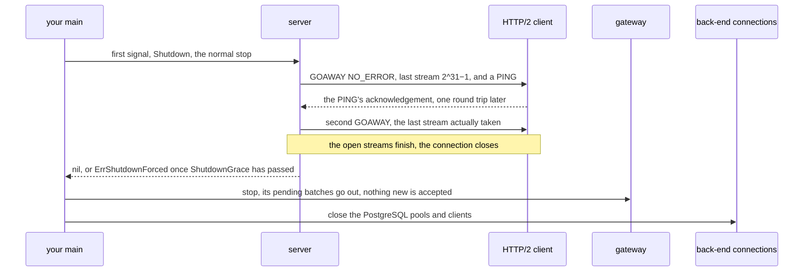

# ADR 0017 — Shutdown drains, it does not cut

- **Created:** 2026-10-15
- **Revised:** 2026-10-28 (the two-stage close stated as built); 4 earlier, from 2026-10-15, in its `git log`
- **Theme:** httpstream

## Problem

Cancelling the context of `Serve(ctx)` closed the listener and every
connection in the same gesture. A response being written was cut without
`Connection: close`; an HTTP/2 connection got no GOAWAY (the frame that
tells a client no new request will be taken); an HTTP/3 connection was
closed `H3_NO_ERROR` without waiting for its requests; `web.Shutdown` only
knew how to stop a `*http.Server`. And nothing wrote down in which order a
process that serves streams stops: if the gateway (which batches calls
toward the back end) closes before the handlers, the handlers in flight see
their calls refused; if the connection pools close before the gateway, its
last batches fail. Last, a grace that passed did not show: `Serve` returned
`nil` whether it had answered everything or cut requests, and a
`ServeH2Conn` called directly still cut the socket at the cancellation.

## Decision

**A shutdown is a bounded drain, front to back.**

The order of (1) and HTTP/2's pair of GOAWAY frames from (6), in one
picture:

1. **Order.** A layer stops after the layer that calls it: the server
   first (nothing new admitted, the responses in flight finish), then the
   gateway (its pending batches go out, nothing new accepted), then the
   connections to the back end (PostgreSQL pools, clients). In that order
   no call is refused at a layer whose caller is still running.

2. **Grace.** `Config.ShutdownGrace` (zero means 5 s) bounds, for one
   `Serve`, the time between the cancellation and the return. It covers
   the handler and the response's writes together; `WriteTimeout` bounds
   one write. When it passes, the connections still open are closed under
   their handler and `Serve` returns without waiting for the goroutines
   still inside one: a handler that has not returned after the grace is
   the handler's bug, and waiting for it would turn the bug into a hang.

3. **Two stops.** The normal stop admits nothing more and lets what is in
   flight finish; the forced stop closes every connection and cancels the
   context of every handler still running. `Server.Shutdown(ctx)` is the
   first, `Server.Close` the second; a deployment calls the first on the
   first signal and the second on the next, or when `Shutdown`'s `ctx`
   ends. `Serve(ctx)` is that sequence with `ShutdownGrace` between the
   two, and `ServeH2Conn` and `ServeH3Conn`, called directly on one connection,
   keep the same contract: the cancellation of `ctx` is the normal stop,
   the grace passing the forced one. Their handler receives a context that
   carries `ctx`'s values but not its cancellation: the normal stop is not
   the handler's business, only the forced one cancels it. When the grace
   passes, `Serve`, `ServeH2Conn` and `ServeH3Conn` return `ErrShutdownForced` and
   `Config.Logger` receives a warning with the number of connections cut;
   a drain that ends within the grace returns `nil`.

4. **What closes at once.** The listener, and every HTTP/1.1 connection
   with no request in flight: between two keep-alive requests, or accepted
   and silent. Nothing is owed to it; waiting for it means returning one
   `IdleTimeout` late. An HTTP/2 connection is never cut by this pass,
   idle or not: it is told first (6), and closes itself one round trip
   later.

5. **What finishes.** A connection on which a request has begun to arrive,
   is being handled or is being answered. The response goes out whole; no
   new request is read after it.

6. **What each protocol tells the client.**
   - HTTP/1.1: the last response carries `Connection: close` (RFC 9112
     §9.6: the server "SHOULD send a "close" connection option in its
     final response" and "MUST NOT process any further requests"). A
     shutdown that begins once the header is out can no longer be
     announced: the client finds the close at its next request, the case
     §9.6 describes for a connection the server closed.

   - HTTP/2: GOAWAY `NO_ERROR` with the last stream identifier at 2^31−1 and
     a PING (a frame the client must echo), then, at the PING's
     acknowledgement — the round trip RFC 9113 §6.8 asks to allow for the
     streams already on the wire — a second GOAWAY with the last stream
     actually taken; a stream opened past it is refused `REFUSED_STREAM`,
     the open streams finish, the connection closes. A peer that never
     acknowledges the PING is closed by the grace.

     A connection with no stream open is told the same way and closes at the
     PING's acknowledgement, one round trip later, under `Serve` as under a
     `ServeH2Conn` called directly: closing it at once, as an idle HTTP/1.1
     one is, raced the GOAWAY its own goroutine was queuing and left a POST
     crossing the close unanswered and unannounced — the case RFC 9113 §6.8
     names for its SHOULD.

     A client that has sent only the preface, without the SETTINGS §3.4
     makes follow it, has opened no stream, and its acknowledgement would
     come, if ever, behind that SETTINGS: it is the HTTP/2 form of the
     accepted and silent connection of (4). Deciding at once would be wrong
     the other way: a client sends its preface and SETTINGS together, and a
     shutdown landing between the two reads would cut a connection whose
     SETTINGS, and perhaps a request, is already in the socket — unread
     bytes a close answers with a reset that can erase the GOAWAY.

     So it is told as the others are and given `LingerTimeout` (a second by
     default) for its first frame; without one, a second GOAWAY names stream
     0 — nothing was processed, so a request crossing the close may be
     replayed as is — and the connection closes; a SETTINGS arriving after
     the decision opens nothing.

   - HTTP/3: as on HTTP/2, a pair of GOAWAY frames on the control stream.
     The first names 2^62−4, the highest identifier a server may send: the
     client opens nothing more, and everything it already sent is still
     admitted. Then a QUIC PING (`quic.Conn.Ping`), whose acknowledgement
     measures the round trip in which those requests arrive (RFC 9114
     §5.2: "without losing requests"). Then a second GOAWAY naming the
     first request stream the connection rejects — the one after the
     highest it admitted, decided under the same lock as the admission so
     no stream is both admitted and named (§5.2: "requests with the
     indicated identifier or greater are rejected") — a request from there
     on reset `H3_REQUEST_REJECTED`. A client that never acknowledges is
     closed by the grace.

     The admitted requests are answered, then `H3_NO_ERROR` (or §8.1's
     grease) once the last answer is acknowledged, which
     `quic.Conn.ShutdownWithError` waits for: an application close sent at
     once can overtake the response it follows. Past the grace the
     connection is closed under its handler and `ServeH3Conn` returns
     without waiting for it, as `Serve` does (§2).

   - `web.Shutdown(ctx, srv web.Server, closers...)` stops every
     `Serve(ctx)` in this order, not only a `*http.Server`: `web.Server` is
     `Shutdown(context.Context) error`, which `*http.Server` already has;
     `web.Start(ctx, serve)` runs a `Serve(ctx)` on its own goroutine and
     returns the handle whose `Shutdown` cancels that context and waits for
     the return; `web.Servers(...)` drains several at once, the front being
     one layer whatever the number of listeners. The handle lives in `web`,
     not in `httpstream`, so that `web` does not import the transport and so
     that a server keeps one signal. When `ctx` ends before the drain does,
     a server with a `Close` method is closed (§3's forced stop);
     `web.Shutdown` then returns `context.DeadlineExceeded`, and the closers
     still run.

     A closer that also stops by draining — a `Shutdown(ctx)`
     method, which `gateway.Gateway` has — is stopped under the same `ctx`
     rather than closed. A gateway's `Close` waits for its pipeline without
     a bound, and a pipeline blocked in a call to a back end that does not
     answer would keep `web.Shutdown` from reaching the connection whose
     close releases it. Stopped under `ctx`, the gateway stops waiting at
     the deadline, the connection is closed, and the pipeline returns. A
     closer with `Close` alone runs to its return.

## Rationale

The handler's contract says a request handed over is whole; the symmetric
promise is that a response produced goes out whole. Cutting the socket
during a write loses the client a response the server already computed
and, for a POST, leaves it unable to tell whether to replay. That is why
the drain is the rule and the cut the bounded exception.

The bound of a `Serve(ctx)` is a duration rather than a second entry
point: it has one stop signal, its context, and the caller has nothing to
coordinate. A deployment that wants to hold both stops itself — one signal
to drain, the next to cut — takes `Server`, whose `Shutdown` and `Close`
are those two gestures; `Serve` is only their sequence at a fixed duration.
`web.Shutdown` composes these signals across several servers; it does not
add one.

The order of §1 makes the gateway the layer that waits on the next one:
its pipeline calls the back end that the closers after it close. An
unbounded wait there turns a silent back end into a stop that never ends,
which is what §2's grace refuses for a handler. The shape `Shutdown(ctx)`
is `http.Server`'s and `web.Server`'s, so no interface is added, and
`Close` stays what it was, `Shutdown` without a deadline.

A forced stop that returns `nil` cannot be told from a clean one: the
operator does not learn that responses were lost. Hence a sentinel,
`ErrShutdownForced`, which `errors.Is` recognises, and a warning to the
`Logger` giving the number of connections cut. A `ServeH2Conn` that cut where
`Serve` drains gave one protocol two contracts depending on the entry
point: one contract, the drain, holds for all three functions.

Closing idle connections at once rather than leaving them to the grace is
what `net/http` does (`Shutdown` closes `StateIdle`), and it is what
returns at the cancellation rather than at the next wake of a silent
client. The unavoidable race — a request byte arriving while the close
runs — is the one every HTTP/1.1 server has. A client recovers from it on
its own only for an idempotent request (RFC 9112 §9.3.1, which defers to
RFC 9110 §9.2.2: GET, HEAD, PUT, DELETE), replaying it on a fresh
connection; it SHOULD NOT replay a POST without knowing it was never
applied, and HTTP/1.1 has no GOAWAY to tell it so. A POST caught in the
race can therefore be lost: the client sees a closed connection, not a
response.

Every connection the shutdown ends is closed in the two stages RFC 9112
§9.6 asks for against the TCP reset: the write side first, which is the
client's EOF, then what it still sends read and dropped until it closes or
`Config.LingerTimeout` passes (`tearDown`, `linger`). So a client that
pipelined a request behind the one the shutdown closed on gets the last
response before the reset can erase it. Revision expected if a conformant
client loses responses at shutdown, or when the HTTP/2 and HTTP/3 slices
show the grace has to be per protocol.
