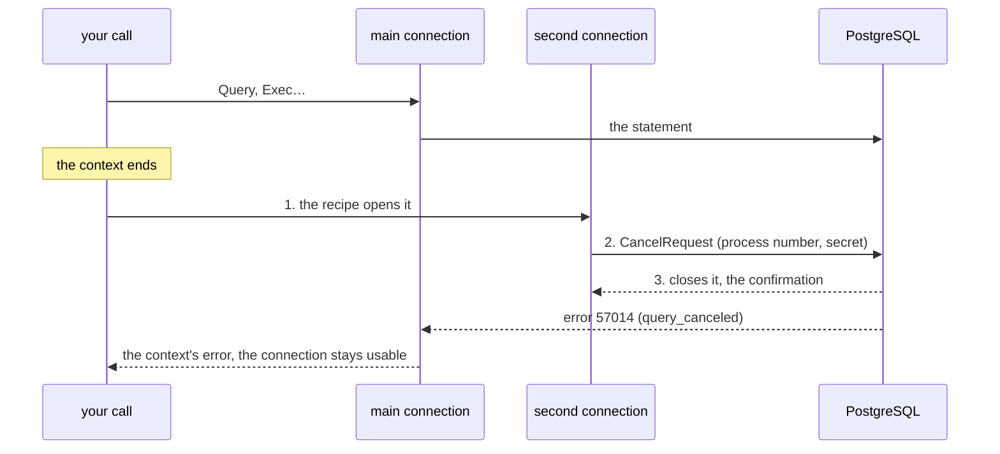

# PostgreSQL

## What this is about

PostgreSQL is a server: your program talks to it over a network
connection, following a **protocol** — an agreement on the shape of the
messages exchanged. In Go, one usually goes through `database/sql` and a
**driver** (the library that speaks the protocol for you). But
`database/sql` hands rows back **one at a time**, which is exactly the
shape Sluice.go is trying to avoid.

`database/postgres` therefore speaks the protocol directly, on Go's
standard library alone. What that buys:

- querying a thousand identifiers in **one round trip** (a question to the
  server and its answer: one network journey, often the slowest thing in
  your whole program);
- loading millions of rows with **COPY**, PostgreSQL's bulk-load mechanism,
  a batch at a time;
- receiving results as a **stream** you read at your own pace, which the
  server produces at that pace.

## Connecting

You give Sluice.go a **connection recipe** — how to reach the server — and
it handles everything after, including **authentication** (proving to the
server who you are):

```go
ctx, cancel := context.WithTimeout(context.Background(), 30*time.Second) // past that, give up
defer cancel()

conn, err := postgres.Connect(ctx, postgres.DialTLS("db.internal:5432", nil), postgres.Config{
    User:     "orders",
    Database: "orders",
    Password: os.Getenv("PGPASSWORD"),
    Params:   map[string]string{"application_name": "orders-etl"},
})
if err != nil { return err }
defer conn.Close()
```

`DialTLS` encrypts the connection ([Encrypting the connection](#encrypting-the-connection));
`DialTCP` opens a plain socket, for a loopback or a network that is already
encrypted. The context bounds the dial and the handshake, nothing else:
once `Connect` has returned, nothing of it stays on the connection, and a
query run an hour later is bounded by its own context alone.

> **In plain terms: the recipe.** `Connect` does not take a socket but a
> function that knows how to open one. That is because it needs one more
> than once: cancelling a running query goes through a second connection to
> the same server, opened the same way.

A context that expires while the server is running a statement cancels it
on the server, through that second connection:
[Cancelling a running query](#cancelling-a-running-query) says why this
matters and what the package does for you.

By default, authentication uses SCRAM-SHA-256: the password never travels
as is. Sending it in cleartext is possible but must be asked for explicitly
(`AllowCleartextPassword`), because only you know whether the network your
recipe reaches may carry a secret.

Demanding more of the server — that it ask for a password, that the proof
be bound to its certificate — is set further down, in
[Demanding more of authentication](#demanding-more-of-authentication).

> **In plain terms: no pool.** A *pool* is a reserve of open connections
> shared by everyone. There is none here, because batching calls
> (`gateway`, see [Web](web.md)) does with **one** connection what a pool
> does with sixty-four, and how many connections to open is a decision for
> your application, not for the library.

A wrong password arrives as a server error with code `28P01`; an
authentication method the package refuses (`md5`, deprecated) arrives as
`ErrAuthUnsupported`. Two different errors because they are fixed
differently.

## Reading

A query returns a `Source[Row]`: a stream of batches of rows, and the error
to consult afterwards (see [Getting started](getting-started.md) for
`Source`).

```go
keys := []int64{1, 2, 3 /* … a thousand */}
src := conn.Query(ctx,
    "SELECT id, total FROM orders WHERE id = ANY($1)",
    []postgres.Param{{OID: pgtype.OIDInt8Array, Value: pgtype.AppendInt8Array(nil, keys)}}, // the parameter: its type, its encoded value
    postgres.QueryConfig{BatchRows: 1024},
)
for b := range src.Stream() {
    for _, row := range b.Items {
        idBytes, isNull := row.Value(0)       // column 0, as bytes, and "is it NULL?"
        id, err := pgtype.DecodeInt8(idBytes)
        // …
    }
}
if err := src.Err(); err != nil { return err }
```

Three ideas in this code.

**Values never go into the query text.** The `$1` is a **parameter**: a
slot the server fills with the value sent separately, in binary. That is
what makes **SQL injection** (slipping SQL into a value to hijack the
query) impossible by construction, not by vigilance. Each parameter is a
`postgres.Param`: its value encoded in binary, and its type as an **OID**
(the number PostgreSQL gives each type, here `OIDInt8Array` for
`bigint[]`). An OID of zero lets the server infer the type from where the
parameter appears; name it when the inference could guess wrong.

**`= ANY($1)` rather than `IN (…)`.** With `IN`, a thousand values make a
thousand slots and a different query shape for every number of values,
which the server must prepare each time. With `= ANY`, the whole array is
**one** parameter: one shape, one plan, whatever the number of keys. That
is the shape to remember.

**`BatchRows` is the back-pressure.** The server sends that many rows, then
waits for you to ask for more. If you stop reading, it stops sending. Your
program's memory is bounded by the size of the batch, not of the result:
that is what makes a ten-million-row result readable. The price: one round
trip per batch.

> **In plain terms: one round trip for a small read.** A read that fits in
> one batch (a row by its identifier) costs a single round trip from its
> second execution on, with nothing to set. The connection keeps the
> queries it has seen (up to 512, prepared on the server;
> `Config.StatementCacheSize` changes the bound, and a negative value turns
> the cache off) and remembers how
> many rows the last execution returned: if they fit in one batch, the
> query asks for everything at once. The first execution, or a query that
> returned more than a batch, is read batch by batch. What this gives up,
> once: a query that is usually small but, for this particular parameter,
> returns millions of rows, and that you stop reading midway. The server
> was told to produce everything; on a connection opened by `Connect`,
> outside a transaction, a query that starts with `SELECT`, `VALUES` or
> `TABLE` is then **cancelled** (the same cancellation as when a context
> ends, above) once two batches past the stop have been read. Any other
> query (`WITH`, `INSERT ... RETURNING`, or any query inside a transaction)
> is read to the end before the connection can be used again, because
> cancelling it would undo what it wrote, or the whole transaction. A
> `SELECT` that calls a function which writes loses those writes on the
> stop: read it with `FetchBatches`. `QueryConfig.Fetch`
> forces the choice: `FetchAll` asks for everything from the first
> execution, `FetchBatches` always reads batch by batch.

> **A round-trip trap.** If you expect one row and ask for `BatchRows: 1`,
> the server sends the row then waits, because it cannot know there is no
> other; your program asks again, and pays a round trip to learn there is
> nothing. Ask for one more than you expect.

## Decoding

A `Row` is a view into its batch, valid for the call (rule 1 of
[Getting started](getting-started.md)). `row.Value(col)` returns a column's
bytes and a boolean "is it NULL?". **NULL is never the empty value**: an
absent string and an empty string are two things, and the protocol tells
them apart.

The codec lives in its own package, `database/postgres/pgtype`, which needs
no connection. Its `Decode*` functions turn bytes into a Go value:
`DecodeInt8` for a `bigint`, `DecodeText` for a `text`, `DecodeTimestampTZ`
for a date with a time zone, `DecodeNumeric` for an exact amount. The `Scan*` functions of
`postgres` do the same for **a whole column** of a batch in one pass
(`ScanInt8(dst, rows, col)`) — the shape that produces the next array of
keys to send as `= ANY`.

### The codecs, in one table

Every type below has the same pair in `pgtype`, `AppendX`/`DecodeX`, named
after the PostgreSQL type. The first thirteen also have a one-dimensional array
(`AppendXArray`/`DecodeXArray`), the same array with NULL elements
(`AppendNullableXArray`/`DecodeNullableXArray`, over `[]Null[T]`), and a
column scanner (`ScanX`). The others have the scalar pair only; what is
missing is listed in [Limits](limits.md), not discovered at use.

| PostgreSQL | Go | X | Array | Array with NULLs | Scan |
|---|---|---|---|---|---|
| `bool` | `bool` | `Bool` | yes | yes | yes |
| `int2` | `int16` | `Int2` | yes | yes | yes |
| `int4` | `int32` | `Int4` | yes | yes | yes |
| `int8` | `int64` | `Int8` | yes | yes | yes |
| `float4` | `float32` | `Float4` | yes | yes | yes |
| `float8` | `float64` | `Float8` | yes | yes | yes |
| `text`, `varchar`, `char(n)`, `name` | `string` | `Text` | yes | yes | yes |
| `bytea` | `[]byte` | `Bytea` | yes | yes | yes |
| `uuid` | `[16]byte` | `UUID` | yes | yes | yes |
| `timestamptz` | `time.Time` (UTC) | `TimestampTZ` | yes | yes | yes |
| `timestamp` | `time.Time` (no zone) | `Timestamp` | yes | yes | yes |
| `date` | `time.Time` (midnight UTC) | `Date` | yes | yes | yes |
| `numeric` | `Numeric` (exact) | `Numeric` | yes | yes | yes |
| `json` | `[]byte` | `JSON` | — | — | as text |
| `jsonb` | `[]byte` | `JSONB` | — | — | — |
| `inet`, `cidr` | `netip.Prefix` | `Inet`, `CIDR` (one decoder) | — | — | — |
| `interval` | `Interval` | `Interval` | — | — | — |
| `time` | `TimeOfDay` | `Time` | — | — | — |
| `timetz` | `TimeTZ` | `TimeTZ` | — | — | — |
| `macaddr`, `macaddr8` | `[6]byte`, `[8]byte` | `Macaddr`, `Macaddr8` | — | — | — |
| `bit`, `varbit` | `Bits` | `Bits` | — | — | — |

**NULL has one form in the connector: `pgtype.Null[T]`** — the value beside a
`Valid` bit, no pointer, so no allocation. The nullable arrays carry
`[]Null[T]`, and a generated hydrator (next section) fills a
`pgtype.Null[T]` field. A `Scan*` refuses a NULL rather than writing a
zero; `ScanNulls` gives the mask of a column that may hold one. In your own
structs, `*T` is accepted too, because the struct is yours; it costs the
allocation `Null[T]` does not.

> **In plain terms: `numeric`.** A `numeric(12,2)` column is chosen
> precisely when a floating-point number would lose something (cents).
> Sluice.go keeps those values **exact**, and every lossy conversion is
> named: `n.Float64()` says what it does; `n.String()` renders `10.00`, not
> `10`, because that is what an invoice prints.

An error returned by the server is a `*postgres.Error` with its
**SQLSTATE** (`Code`), a standardised five-character code, the only part
stable across versions and languages, and the constraint concerned:
`e.Code == "23505"` means "duplicate key" whatever the server's language.

## Hydrating: from rows to structs, without reflection

**Hydrating** a struct means filling its fields from a row. Doing it field
by field, with **reflection** (Go's ability to inspect a type at run time),
costs on every field of every row — the cost the batch exists to avoid.
`cmd/sluicegen` therefore generates, for each of your structs, the code
that hydrates a **whole batch** in one loop:

```go
//go:generate go run github.com/mlagarrigue/sluice/cmd/sluicegen -type Order -in order.go

type Order struct {
    ID        int64                  `db:"id"`
    Total     float64                `db:"total_amount"`
    Label     string                 // no tag: the column is named label, by convention
    CreatedAt time.Time              `db:"created_at"`
    Note      *string                `db:"note"`   // nullable: a pointer is one way to say "may be NULL"
    Weight    pgtype.Null[float64] `db:"weight"` // nullable: the other way, without a pointer
    Computed  int64                  `db:"-"`      // not a column
}
```

`go generate ./...` produces a file beside it, with two functions:

```go
var plan entity.OrderPlan
var bound bool
for b := range src.Stream() {
    if !bound {
        plan, err = entity.BindOrder(b.Items[0].Fields()) // once per result
        bound = true
    }
    orders, err = entity.HydrateOrder(orders[:0], b.Items[0].Rows(), plan)
    // …
}
```

`BindOrder` matches the result's columns to the fields **by name**, not by
position, and checks the **types**: if a migration changed a column from
`int4` to `bigint`, or a `SELECT` reordered two columns, the error comes
when the result opens, not in the middle of a batch as plausible, wrong
values. `HydrateOrder` then fills a slice from each batch.

> **In plain terms.** The generated file is committed with your code, and a
> test regenerates it and compares: if someone changes the struct without
> rerunning the generator, the build fails instead of leaving a silent
> difference. Measured: 54 ns per row for six columns
> ([the row](../benchmarks.md#joins-and-hydration-in-isolation)). A `*T` field costs
> one allocation per row (the pointer); a `pgtype.Null[T]` field costs
> none, which is why it is the form to prefer when rows are many.

## Writing

### In bulk: COPY

To load many rows, PostgreSQL has a dedicated mode, COPY, far faster than
repeated `INSERT`s. Sluice.go uses it in binary, a batch at a time:

```go
cp, err := conn.CopyFrom(ctx,
    "COPY orders (id, label) FROM STDIN WITH (FORMAT BINARY)",
    postgres.CopyConfig{RowsPerTx: 100_000})
if err != nil { return err }

var buf []byte
for _, o := range orders {
    buf = buf[:0]
    buf = postgres.AppendTupleHeader(buf, 2)                             // a row of two columns
    buf = postgres.AppendField(buf, pgtype.AppendInt8(nil, o.ID))
    buf = postgres.AppendField(buf, pgtype.AppendText(nil, o.Label))
    if err := cp.WriteTuples(buf, 1); err != nil { return err }
}
if err := cp.Close(); err != nil { return err }
```

`RowsPerTx` is **required**. A **transaction** is a group of writes the
database commits or discards as a block; putting a whole eight-hour load in
one transaction is everyone's reflex, and it is a defect, for three
reasons: nothing is saved until the end (one network blip and everything is
lost), restart is all or nothing, and a long transaction stops PostgreSQL
from cleaning up in the **whole** database while it lasts — your other
applications slow down without knowing why. By writing `RowsPerTx:
100_000`, you say every how many rows the database commits.

> **In plain terms: at-least-once.** If the load is interrupted after its
> third transaction, the first three are in the database and nothing says
> where it stopped. It is up to you to make reloading harmless (with a
> unique key, for instance). And index the table **after** the COPY, not
> during: about twice as fast.

### Retail: transactions

```go
tx, err := conn.Begin(ctx, postgres.TxConfig{})
if err != nil { return err }
defer tx.Rollback() // a no-op if Commit succeeded: the safety net

if err := tx.SetLocal(ctx, "app.tenant_id", tenant); err != nil { return err } // visible to row-level security
tag, err := tx.ExecParams(ctx, "UPDATE orders SET shipped = true WHERE customer = $1",
	[]postgres.Param{{OID: pgtype.OIDText, Value: pgtype.AppendText(nil, customer)}})
if err != nil { return err }
n, _ := tag.RowsAffected() // how many rows changed, by the server's count
return tx.Commit(ctx)
```

`ExecParams` sends the values as **bound parameters** (`$1`, `$2`…): they
travel apart from the SQL text and cannot be read as SQL. It returns the
**tag** the server sends when the statement completes (`UPDATE 3`,
`INSERT 0 1`); `RowsAffected` reads its count, and answers "no count" for a
statement that has none, such as `SET`. To read the rows **and** the tag —
an `UPDATE … RETURNING` whose changed rows you want — go through `Query`
with `QueryConfig{Tag: &tag}`: the tag is written there once the stream is
read to the end, and its count covers the whole result, even read in
batches. `Exec` takes no values at all: it is
for statements without parameters (creating a table, `SET`…).

`Rollback` takes no context, on purpose: it runs from a `defer`, often
after the request's context has expired, and a block left open on a reused
connection is the worst outcome. A stream obtained from `tx.Query` is read
**before** the `Commit`; afterwards it refuses to run rather than running
outside the transaction under nobody's identity.

## Securing and controlling the connection

What follows is for the day you need it: a server that must prove more than
the defaults ask, a connection that crosses a network you do not trust, a
query that must stop before it ends. The first `Connect` above needs none of
it beyond `DialTLS` and its defaults.

### Demanding more of authentication

Two options make the client demand what the server only offers by default.
`RequireAuth` refuses a server that declares the connection authenticated
without asking for anything: that is what a role configured for `trust`
gets, and also what an impostor sends, since the message proves nothing
about who sent it. `ChannelBinding` set to `ChannelBindingRequire` refuses
every exchange that is not SCRAM-SHA-256-PLUS, the variant bound to the
server's certificate: a recipe that does not return a `*tls.Conn`, a server
that does not offer the variant, a password asked for in cleartext. Both
refusals arrive as `ErrAuth`, before any credential has left the client,
and the message names the option. The third value, `ChannelBindingDisable`,
goes the other way: the exchange is never bound, and the client says so
(libpq's `channel_binding=disable`). It exists for one server: the one
whose certificate is signed by an algorithm with no hash, Ed25519, for
which the binding is undefined (RFC 5929 §4.1). The default refuses that
server rather than fall back without saying so.

> **In plain terms: channel binding.** With SCRAM alone, the server proves
> it knows your password and you prove you know it too, but neither side
> proves *which* connection the proof was made on. An attacker who
> terminates TLS between you and the server can relay the exchange. Channel
> binding mixes a fingerprint of the server's certificate into the proof: a
> relay holding another certificate fails. The server offers it when it has
> a certificate (`ssl = on`); `ChannelBindingRequire` makes its absence an
> error instead of a silent fallback, `ChannelBindingDisable` turns it off
> openly.

### Encrypting the connection

A PostgreSQL server does not begin with a TLS handshake the way an HTTPS
server does. The client opens a plain socket and sends an **SSLRequest** —
eight bytes, a code in place of a protocol version — and the server answers
with a single byte, `S` to accept or `N` to refuse. Only then does the TLS
handshake start. A `tls.Dial` aimed straight at port 5432 therefore fails,
with an error that looks like a certificate problem rather than a protocol
mismatch. `DialTLS` performs that negotiation:

```go
roots, err := x509.SystemCertPool()
if err != nil { return err }
dial := postgres.DialTLS("db.internal:5432", &tls.Config{RootCAs: roots, MinVersion: tls.VersionTLS12})
conn, err := postgres.Connect(ctx, dial, postgres.Config{ /* … */ })
```

Three things are done for you there. It reads **exactly one byte** before
handing the socket to TLS: bytes read ahead would have been slipped in by a
third party before encryption, and would be treated as coming from the
server. On `N`, it **refuses** rather than carry on in plaintext, which is
exactly what an attacker able to strip one byte is hoping for; on an error
message, it refuses without repeating it, since nothing has authenticated
the server yet. And when `ServerName` is empty, it fills in the host of the
address, so the certificate is checked against the name you dialled. Which
certificates to trust stays yours (`RootCAs`), never `InsecureSkipVerify`:
an encrypted connection to anyone at all protects against nothing. The
complete, commented example is in
[`example_tls_test.go`](../../database/postgres/example_tls_test.go).

Since PostgreSQL 17, the client may also skip the SSLRequest and open TLS
directly (`sslnegotiation=direct` in libpq): one round trip fewer, and not a
single byte in clear. The protocol then requires the client to announce
**ALPN** `postgresql`, and the server refuses the handshake without it.
That is the `DialTLSDirect` recipe, which takes the same arguments as
`DialTLS`:

```go
conn, err := postgres.Connect(ctx,
    postgres.DialTLSDirect("db.internal:5432", &tls.Config{RootCAs: roots, MinVersion: tls.VersionTLS12}),
    postgres.Config{ /* … */ })
```

It announces `postgresql` in place of whatever your `tls.Config` held in
`NextProtos`, and refuses a server that completes the handshake without
having chosen it, as libpq does: that server has not said it speaks
PostgreSQL. A server at 16 or older does not understand this form and fails
the handshake: it only fits when you know which server is on the other
side; otherwise, `DialTLS`.

> **In plain terms: ALPN.** A label the client slips into the TLS handshake
> to say which protocol it will speak next (`h2` for HTTP/2, `postgresql`
> here). Without it, a server that accepts TLS directly could be fooled by a
> client that believes it is talking to something else; the label closes
> that confusion.

### Cancelling a running query

A statement running on the server does not stop because your program no
longer wants its answer. As long as it runs, three things stay taken:

- its **locks**: the reservations a statement places on rows or tables so
  that nobody changes them underneath it. A long `UPDATE` blocks every other
  `UPDATE` on the same rows;
- the server's processor, memory and disks, which every other query shares;
- the connection itself: the protocol lets nothing else through until the
  statement has finished.

The classic case is a slow query behind an HTTP deadline: the visitor left
long ago, the database is still working for them, and the following queries
wait on its locks.

The context passed to a query is not enough to stop it. It is checked
between two batches, which stops the client pulling; but while the server
is computing and has not sent its first row, the client is waiting for it,
and the server knows nothing about the context. The protocol has a separate
message for this, the **CancelRequest**: a small packet that carries the
**cancellation key** the server gave to the session (its process number and
a secret), and that travels on a **second connection** to the same server,
because the first one is busy with the running statement and its bytes are
taken.

On a connection opened by `Connect`, you have nothing to write. As soon as
a context ends while the connection is waiting for the server (in `Query`,
`Exec`, `ExecParams`, `Copier.WriteTuples` or `Tx.Pipeline`) the package:

1. reopens a connection with the recipe given to `Connect`;
2. writes the CancelRequest on it;
3. waits for the server to close that second connection. This is the
   **confirmation**: the server notifies the statement before closing, and
   nothing is sent on the main connection before that close, so a
   cancellation still on its way cannot land on the next statement.

The three steps, with the two connections:



The server then abandons the statement with code `57014`
(`query_canceled`). The call returns the context's error, wrapped (the
server's error stays reachable through `errors.As`), and the connection
stays usable:

```go
ctx, cancel := context.WithTimeout(ctx, 2*time.Second)
defer cancel()
err := conn.Exec(ctx, "UPDATE orders SET status = 'late' WHERE due < now()")
if errors.Is(err, context.DeadlineExceeded) {
    // the server abandoned the UPDATE and released its locks; conn is still good
}
```

For COPY and the pipeline, the same cancellation has the effects of their
shape. A `WriteTuples` that was waiting for the server's answer returns the
context's error, the transaction rolled back; a context that expires **between**
two batches leaves the transaction open, and it is up to you to choose
between `Abort` and `Close` ([In bulk: COPY](#in-bulk-copy)). In a pipeline,
the part in progress fails, the following ones do not run, and `Pipeline`
returns the context's error next to `ErrPipelineAborted`, the transaction
aborted as after any failure of a part.

**When nothing confirms.** `Config.CancelTimeout` (5 seconds by default)
bounds the three steps together. If the recipe fails, or if the server does
not close in time, the package no longer knows where the request is: lost,
or still on its way to the server, where it would cancel the statement
after this one. So it closes the main connection, which is also what frees
your call, blocked on a read the server might never serve. The call returns
the context's error with `ErrConnBroken`: the connection is no longer good,
open another. `Config.Logger` (`slog.Default()` if nil) receives a warning
that says why.

One case stands apart: the statement finished just before the close
reached it. The call then returns its real result (`nil`, the rows
delivered) and it is the next call that finds `ErrConnBroken`. The warning,
with `statement_completed=true`, is the only trace of the failed
cancellation. The reason: an `INSERT` reported as failed after being
committed would be replayed by the caller, and the row would exist twice.

**The recipe does the cancelling.** Since cancellation goes through the
recipe, it has the recipe's properties. With `DialTCP`, the cancellation
secret crosses the network in cleartext; anyone who reads it can cancel
this session's queries until it closes. That is harmless on a loopback:

```go
conn, err := postgres.Connect(ctx, postgres.DialTCP("127.0.0.1:5432"), cfg)
```

With `DialTLS`, each cancellation negotiates TLS like the main connection,
with the same configuration; the server accepts a CancelRequest inside TLS:

```go
conn, err := postgres.Connect(ctx, postgres.DialTLS("db.internal:5432", &tls.Config{RootCAs: roots}), cfg)
```

A **recipe of your own** (a UNIX socket, a tunnel, a proxy) is any function
of the shape `DialFunc`. For example, the UNIX socket of a server on the
same machine (here at the path used by the Debian and Ubuntu packages):

```go
unix := func(ctx context.Context) (io.ReadWriteCloser, error) {
    var d net.Dialer
    return d.DialContext(ctx, "unix", "/var/run/postgresql/.s.PGSQL.5432")
}
conn, err := postgres.Connect(ctx, unix, cfg)
```

It must keep three promises, and any `net.Conn` opened inside the function
keeps them: return a **new** connection on every call, respect the context
it receives (otherwise the cancellation overruns `CancelTimeout`), and
accept a `Close` while a `Read` is blocked.

The trap is the first promise. A recipe that opens the socket once and
returns it on every call gets through `Connect` without trouble, and then
the first cancellation receives the very connection it was meant to cancel:

```go
nc, err := net.Dial("tcp", "db.internal:5432")
dial := func(context.Context) (io.ReadWriteCloser, error) { return nc, nil } // wrong: always the same socket
```

The package recognises this case and refuses it (written on the main
connection, the packet would be read as a message of the conversation in
progress), which means an unconfirmed cancellation: connection closed,
`ErrConnBroken`. A different wrapper around the same socket, however, is not
recognised. The rule is therefore simple: open **inside** the function,
never before.

A `Conn` built by `NewConn` has no recipe, so no automatic cancellation:
it is up to you to open the second connection and call `CancelRequest` with
`conn.CancelKey()`.

> **In plain terms: an advisory cancellation.** The CancelRequest is a
> request, not an order. The server looks at it at moments of its choosing
> (checkpoints scattered through its code, between two rows read for
> instance) and a statement that was finishing finishes: the answer may then
> arrive with its result rather than with `57014`. Cancelling is not undoing
> either: what a transaction has already committed stays committed. And a
> cancellation only leaves if your program is there to send it; to bound the
> server's work even when the client has vanished, add a limit on the server
> side, `statement_timeout` in `Params`.

## Following changes: logical replication

A query reads what a table holds now. **Logical replication** reads what
happens to it afterwards: every insert, update and delete, in the order the
server committed them — what is called *change data capture*. The server
keeps the changes in a **slot** until the reader says it has processed them,
and a **publication** names the tables the slot follows. Both are created
once, in SQL, by the database's owner; the role that reads needs the
`REPLICATION` attribute, and the server `wal_level = logical`.

```go
// Once: CREATE PUBLICATION orders_pub FOR TABLE orders;
//       SELECT pg_create_logical_replication_slot('orders_slot', 'pgoutput');
repl, err := postgres.Replicate(ctx, postgres.DialTLS(addr, tlsConfig), cfg,
    postgres.ReplicationConfig{Slot: "orders_slot", Publications: []string{"orders_pub"}})
if err != nil {
    return err
}
defer repl.Close()
src := repl.Changes(ctx)
for b := range src.Stream() {
    for _, c := range b.Items {
        switch c.Kind {
        case postgres.ChangeInsert:
            id, err := pgtype.DecodeInt8(c.New[0].Data) // columns in c.Relation.Columns order
            // …
        case postgres.ChangeCommit:
            repl.Ack(c.EndLSN) // processed: the server may let these changes go
        }
    }
}
return src.Err()
```

> **In plain terms: acknowledging.** The server keeps every change until you
> call `Ack` with a position past it. Acknowledge after the work is done, not
> before: a reader that stops in between gets the unacknowledged changes again
> when it starts over, which is safe; a reader that acknowledged first would
> have lost them. The flip side is that a slot nobody reads keeps the server's
> log growing, so drop a slot you no longer use
> (`SELECT pg_drop_replication_slot('orders_slot')`).

A transaction arrives as a `Begin`, its row changes and a `Commit`, and
nothing of it before the server has committed it. The values are binary and
decode with `pgtype`, like a query's; a `NULL` has `Status` `ValueNull`. The
design is in [ADR 0023](../design/adr/0023-logical-replication.md).

### Signals: LISTEN and NOTIFY

`NOTIFY` is PostgreSQL's built-in publish and subscribe: one session says
`NOTIFY orders, '42'`, and every session that ran `LISTEN orders` receives
the channel, the text (the *payload*) and the sender's process number, as
soon as the sending transaction commits. `Listen` opens a connection that
does only that:

```go
l, err := postgres.Listen(ctx, postgres.DialTLS(addr, tlsConfig), cfg,
    postgres.ListenConfig{Channels: []string{"orders"}})
if err != nil {
    return err
}
defer l.Close()
src := l.Notifications(ctx)
for b := range src.Stream() {
    for _, n := range b.Items {
        // n.Channel, n.Payload, n.PID
    }
}
return src.Err()
```

> **In plain terms: a signal, not a log.** A notification sent while nobody
> listens is gone, and nothing is replayed after a restart: use it to say
> "look at the table", and read what changed from the table (or from
> logical replication, above). And keep reading: the server queues what
> listeners have not taken yet, for the whole instance, and when that queue
> is full it is the *senders'* transactions that fail.

The design is in [ADR 0024](../design/adr/0024-listen-notify.md).

## What is not there

- **No connection pool**: a `Conn` is one connection; holding several is
  the caller's.
- **No automatic resumption of an interrupted load**: delivery is
  at-least-once, and the resumption point lives in your schema.
- **No `COPY ... TO STDOUT`**.
- **`md5` authentication is refused.**
- **Types**: no `money` or `tsvector`; arrays and column scanners for the
  first thirteen types of the table above only.

The detail: [Limits](limits.md).

## Measured

Against pgx, the reference driver, on one connection each: parity on a
point read, with no option (196 µs against 197 on another
server), 348 µs against 363 for a thousand keys in `= ANY` with
`FetchAll`, a wide scan 4% slower (9.8 ms against 9.4) but in 23
allocations against 280,008, and a faster COPY (7.3 ms against 8.3). The
last three figures are those of the table re-measured on 2026-10-19; the
rows and the method: [Measurements](../benchmarks.md).

## You can now

- open a connection through a recipe and read a table in batches;
- send a thousand keys in one round trip with `= ANY($1)`;
- load rows with COPY, and run a transaction;
- cancel a running statement by ending its context.

The package's examples compile and run as tests; the integration test runs
against the PostgreSQL the `SLUICE_PG` variables name, and skips without
them:

```sh
go test -run Example -v ./database/postgres/
go test ./example/orders -run TestIntegration -v
```

A variant to try, against that server: give the context of the
cancellation example a millisecond on a `SELECT pg_sleep(1)`. The call
returns `context.DeadlineExceeded`, and the connection stays usable.
